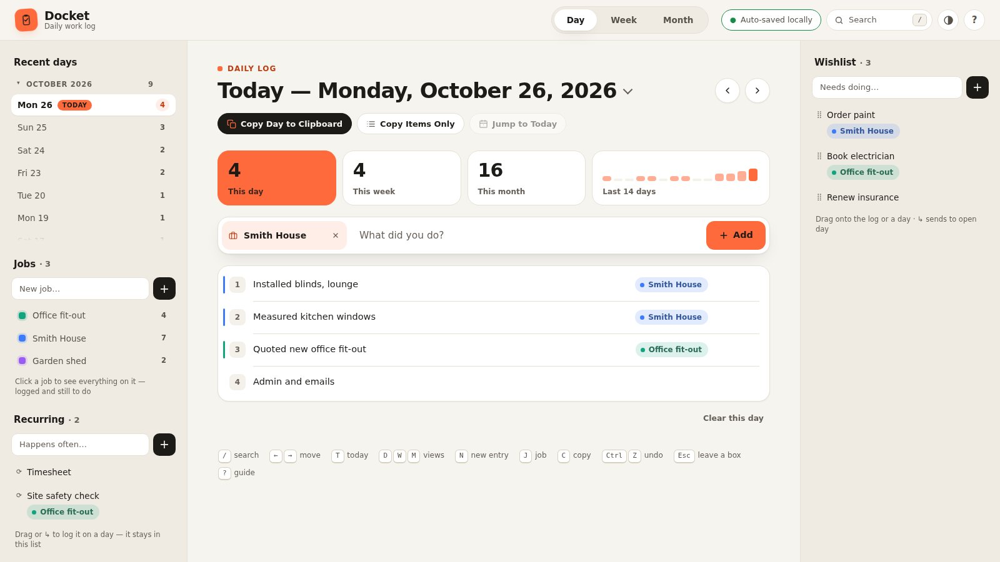
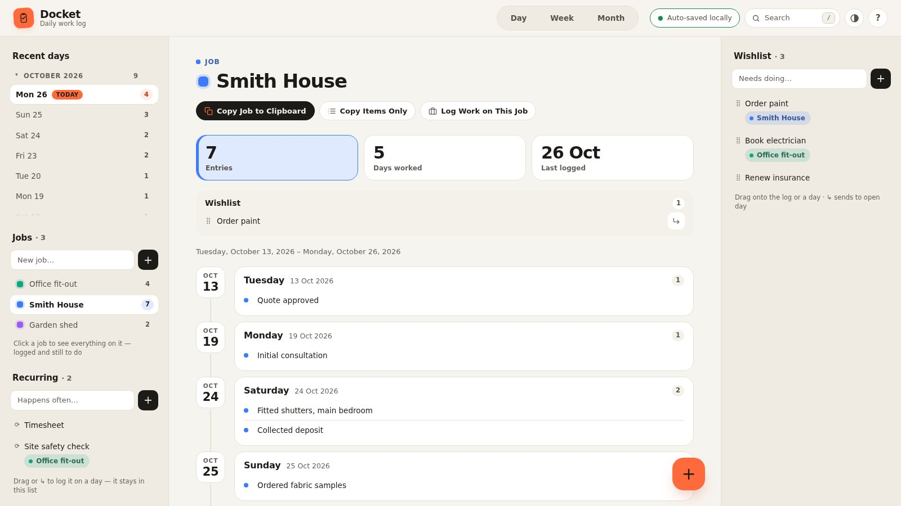
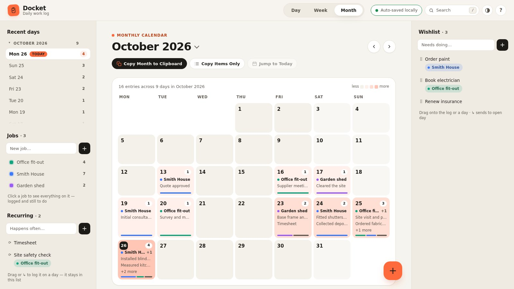
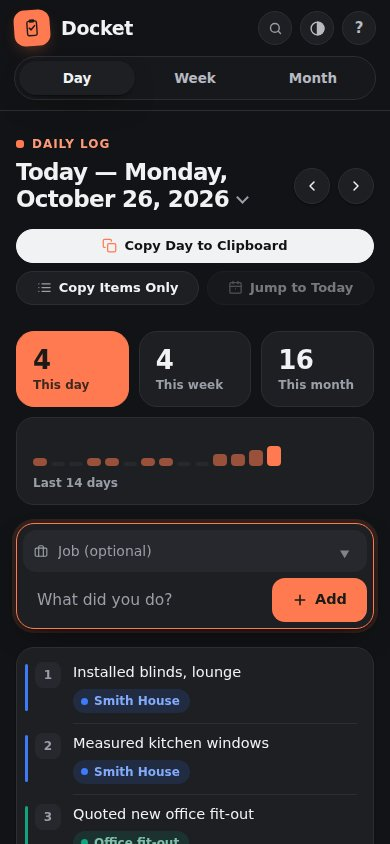

# Docket — daily work log

Log what you did each day, group it by **job** (a client, site or project), and copy it straight into an email, timesheet or invoice. Docket is bright, colour-coded by job, keyboard-friendly, and private: everything is stored on your own device, and nothing is sent anywhere.

It comes two ways, from the same code:

- **An installable app (PWA).** Open it from the web, click **Install app**, and it gets its own window and Start menu / dock icon, and works offline.
- **A single HTML file.** Download `Docket.html` and double-click it. There's no install, no server and no internet needed.



## Features

- **Daily log.** Type what you did and press Enter. Day, Week and Month views, stat tiles and a 14-day activity chart.
- **Jobs.** Set a job once and log several entries against it. Each entry shows its job, and the **Job view** gathers everything on a job across every day, with totals. **Copy Job** gives you an invoice-ready list.
- **Uses the whole screen.** On a PC, your lists sit on the left, the log fills the middle, and the Wishlist has its own panel on the right. Smaller screens fold neatly into fewer columns.
- **Wishlist and Recurring.** Queue things to do, or keep often-repeated tasks. Both can carry a job, and logging one (↳ or drag) carries the job onto the entry.
- **Search everything.** `/` or Ctrl+K finds any entry, job, wishlist or recurring item — by words, job or date — and jumps straight to it.
- **Reorder anywhere.** Drag entries up or down in the Day, Week or Job view, or use ↑ ↓ on the keyboard; touch screens get ▲ ▼ buttons. Copies and exports follow your order.
- **Quick add from the week.** The + on any Week card logs straight onto that day.
- **Move and edit anywhere.** Edit or delete entries from the Day, Week and Job views. Move an entry by changing its date or dragging it onto another day. Link anything to a job by dropping it on that job.
- **A colour per job.** Each job's colour runs through its pills, entries, calendar bars and Job view, so you can tell work apart at a glance. Click a job's dot to change it.
- **Month calendar.** Shaded like a heatmap by how busy each day was, with each day's jobs named, busiest first, and a bar showing how the day split.
- **Light and dark.** Follows your system, or pin either with the theme button.
- **Copy to clipboard.** Copy the open day, week, month or job as a dated bulleted list, or just the lines.
- **Undo** for deletes, moves, links, imports and **Clear data** — the button, or Ctrl+Z for a minute afterwards.
- **Import and export.** JSON is the exact backup. CSV opens in Excel. Both carry everything, including jobs. See [docs/DATA-FORMAT.md](docs/DATA-FORMAT.md).
- **Backup reminder.** Shows when you last exported, and nudges you when it's been a while and the log has changed.
- **Keyboard shortcuts.** `/` search, `←` `→` move, `T` today, `D` `W` `M` views, `N` new entry, `J` job, `C` copy, `Ctrl+Z` undo, `Esc` leave a box, `?` guide.
- **Built-in guide.** It opens on first use, and the **?** button brings it back. Every control explains itself on hover or keyboard focus.

| Job view | Month view | Dark, on a phone |
|---|---|---|
|  |  |  |

## Your data

- Docket saves to the browser's local storage as you type. There's no account and no cloud copy.
- Data belongs to **one browser on one device**. The installed app and the standalone file each keep their own. To move between them, or to a new computer, use **Export JSON** in one and **Import JSON** in the other.
- Clearing the browser's site data erases the log, so keep an occasional **Export JSON** as a backup. The **Backup & data** section shows when you last exported and reminds you when it's been two weeks and the log has changed.
- Docket asks the browser to keep its storage **persistent**, so it isn't cleared to free space.
- **CSV exports are safe to open in Excel:** text that would run as a formula (starting `=`, `+`, `-` or `@`) is written with a leading apostrophe, which import removes again.
- **Left open overnight?** Today moves on to the new date by itself.
- **Clear data…** (under Backup & data) wipes chosen parts so you can start fresh or re-import a backup cleanly. It offers to export first, and Undo is there afterwards.
- Data from earlier versions, including from when the app was called Track, loads unchanged.
- **Two tabs open?** They stay in step: a change in one shows up in the other, so neither overwrites the other's work.
- **Storage blocked** (some private windows, site data turned off)? Docket still works, marks itself **Not saved**, and tells you to export before closing.
- **Damaged data**, from a hand-edited file for example, is repaired on load rather than breaking the app. The original is kept under a `.before-repair` key. See [docs/DATA-FORMAT.md](docs/DATA-FORMAT.md).
- **Undo is safe:** it only works while nothing has changed since, so it can never throw away newer work.

## Accessibility

Docket is built to WCAG 2.1 AA. An automated axe-core check covers every view and dialog in both themes on every test run. Everything works from the keyboard: shortcuts, Tab to any control, and ↑ ↓ to reorder. Every action that needs a drag or a hover has a non-drag, non-hover route, and touch screens get always-visible buttons in place of hover ones.

## Development

Requires **Node.js 20+** (22 recommended; see `.nvmrc`).

```bash
npm install
npm run dev      # rebuilds on change and serves http://localhost:3000
npm test         # builds, then runs the Playwright end-to-end suite (incl. accessibility)
npm run check    # ESLint + syntax checks
```

The first time on a new machine, install the test browser with `npx playwright install chromium`.

### How it's put together

```
src/
  index.html             page markup
  styles.css             all styles
  app.js                 all behaviour (plain JS, no framework, no runtime deps)
  sw.js                  service worker (offline support)
  manifest.webmanifest   PWA manifest
  icons/                 app icons (icon.svg is the source)
scripts/
  build.js               inlines CSS + JS into one file → dist/
  dev.js                 build-watch + server, cross-platform
  screenshots.js         regenerates docs/screenshots/
  icons.js               renders the PNG icons from icons/icon.svg
server.js                Express server for hosting the app
tests/                   Playwright end-to-end and accessibility suites
docs/                    architecture, data formats and screenshots
eslint.config.js         lint rules
```

The code is split into separate files to make it easy to work on. `npm run build` inlines it back into one self-contained page, which is what keeps the double-click download working. The build writes `dist/index.html` (served by the server) and `dist/Docket.html` (the standalone download). `dist/` is generated output and isn't committed.

**Before changing the code, read [docs/ARCHITECTURE.md](docs/ARCHITECTURE.md).** It covers the render cycle, the storage guards, drag-and-drop, undo, and the rules every change follows.

## Deploying to Railway

Docket needs no database. All data stays in each user's browser, so the server only hands out static files. That keeps hosting cheap and means there's no user data to secure. The trade-off is no automatic sync between devices; JSON export/import covers moving data.

1. Create a Railway project from this GitHub repo.
2. Railway reads `railway.json`, which sets:
   - **Build command:** `npm run build`
   - **Start command:** `npm start`
   - **Health check:** `/healthz`
3. Generate a domain under **Settings → Networking**. Railway serves it over HTTPS, which installing the app requires.

**Environment variables**

| Variable | Default | Purpose |
|---|---|---|
| `PORT` | `3000` | Port to listen on. Railway sets this for you. |
| `HOST` | `0.0.0.0` | Interface to bind. |

See `.env.example`. There are no secrets to configure.

**Endpoints**

| Path | |
|---|---|
| `/` | The app |
| `/download` | The standalone `Docket.html`, as a download |
| `/healthz` | `{"status":"ok","version":"…"}` for health checks |

The build precompresses the page (brotli and gzip), so it downloads at about a fifth of its size. The server sends a strict Content-Security-Policy that allows only the page's own script, by its hash. It also sends anti-framing, `nosniff` and referrer headers, and HSTS over HTTPS. The page and service worker are served `no-cache`, so a new deploy reaches users on their next launch.

## Releasing

1. Bump `version` in `package.json` and add a section to `CHANGELOG.md`.
2. Commit, then tag and push the same version: `git tag vX.Y.Z && git push origin vX.Y.Z`.
3. The **Release** workflow runs the tests and publishes a GitHub Release with `Docket.html` attached, ready to download.

CI runs lint and the full test suite on every push and pull request. Each run also uploads the built `Docket.html` as an artifact.
